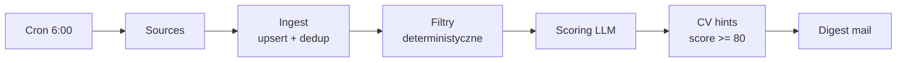

# Job Agent — plan wdrożenia

2026-09-18 · @Someone

## Cel i zakres

Agent zbiera oferty z polskich portali IT, ocenia je względem profilu i codziennie rano wysyła jednego maila z listą najlepszych trafień.

Co robi:

- Pobiera oferty z NoFluffJobs, justjoin.it, protocol.it i pracuj.pl (to ostatnie przez alerty mailowe)
- Deduplikuje te same ogłoszenia występujące na kilku portalach
- Odsiewa oczywiste niedopasowania filtrami deterministycznymi: widełki, seniority, typ kontraktu
- Ocenia resztę przez LLM: wynik 0–100, jedno zdanie uzasadnienia, lista red flags
- Dla najlepszych ofert generuje wskazówki, jak dopasować CV
- Oznacza wysłane oferty, żeby nigdy nie wróciły w kolejnym mailu

Czego świadomie nie robi:

- Nie aplikuje automatycznie. Formularze prowadzą do zewnętrznych ATS-ów, mają captche i zmieniają się co miesiąc. Niezależnie od techniki: masowe aplikacje obniżają konwersję i palą nazwisko u pracodawcy.
- Nie generuje gotowego pliku CV. Podpowiada zmiany, decyzja zostaje po stronie człowieka.
- Nie dopisuje ukrytych keywordów. Parsery ATS czytają plain text, a rekruter widzi biały tekst po zaznaczeniu.

Output: jeden mail dziennie, maksymalnie 10 ofert, każda z wynikiem, uzasadnieniem, widełkami i linkiem. Pod ofertami z wynikiem 80 lub wyżej dodatkowa sekcja ze wskazówkami do CV.

## Stack i architektura

NestJS + Prisma + PostgreSQL na Railway, mail przez Resend. Ten sam stack co Estate Flow, więc setup jest znany, a projekt dokłada trzy nowe tematy: scheduler, pipeline przetwarzania i integracja z LLM.

| Warstwa | Wybór | Dlaczego |
| --- | --- | --- |
| Runtime | NestJS | DI i moduły trzymają źródła rozdzielone |
| ORM | Prisma | upsert + composite unique out of the box |
| Baza | PostgreSQL | tablice na skills, JSON na cvHints |
| Scheduler | @nestjs/schedule | wystarczy na start; BullMQ dopiero przy retry per źródło |
| Mail | Resend | proste API, darmowy tier pokrywa 1 mail dziennie |
| LLM | Claude API | batch po 10 ofert, koszt rzędu groszy dziennie |
| Hosting | Railway | już opłacony, cron działa na worker process |

Przepływ danych:



Każdy krok czyta i zapisuje do bazy, nie przekazuje danych w pamięci. Dzięki temu po przerwanym przebiegu kolejne uruchomienie podejmuje pracę od miejsca, w którym stanęło — nie zaczyna od pobierania ofert.

## Moduł 1 — schema bazy

Cała odporność systemu siedzi w trzech polach: `@@unique([source, externalId])`, `fingerprint` i `sentAt`. Reszta to dane.

```prisma
model JobOffer {
  id           String    @id @default(cuid())
  source       String    // 'nfj' | 'jjit' | 'protocol' | 'pracuj'
  externalId   String
  fingerprint  String
  title        String
  company      String
  url          String
  salaryMin    Int?
  salaryMax    Int?
  contractType String?   // 'b2b' | 'uop'
  seniority    String?
  skills       String[]
  description  String    @db.Text
  publishedAt  DateTime?
  score        Int?
  scoreReason  String?
  redFlags     String[]
  cvHints      Json?
  rejectedBy   String?   // który filtr odrzucił
  sentAt       DateTime?
  createdAt    DateTime  @default(now())

  @@unique([source, externalId])
  @@index([fingerprint])
  @@index([score, sentAt])
}

model SourceRun {
  id        String   @id @default(cuid())
  source    String
  found     Int
  created   Int
  error     String?
  runAt     DateTime @default(now())

  @@index([source, runAt])
}
```

Dlaczego akurat te pola:

- `@@unique([source, externalId])` — pozwala na `upsert` zamiast `insert`. Cron może polecieć pięć razy pod rząd i nic się nie zduplikuje.
- `fingerprint` — dedup między portalami, liczony jako `normalize(company) + normalize(title) + salaryMin`. Normalizacja: lowercase, usunięcie diakrytyków, form prawnych („sp. z o.o.", „S.A.") i sufiksów typu „(Remote)".
- `sentAt` — gwarancja, że oferta nie wróci w jutrzejszym mailu. Warunek digestu to `score >= 70 AND sentAt = null`.
- `rejectedBy` — zapisuje, który filtr odrzucił ofertę. Bez tego kalibracja progów jest zgadywanką: po tygodniu widać, czy próg widełek nie wycina zbyt wiele.
- `SourceRun` — health check. Jeśli `found = 0`, parser padł i chcesz o tym wiedzieć tego samego dnia, a nie po tygodniu ciszy.

## Moduł 2 — źródła

Jeden interfejs, implementacja per portal. Dodanie kolejnego serwisu to nowy plik i jedna linijka w providerach — reszta systemu się nie zmienia.

```ts
export type RawOffer = {
  externalId: string;
  title: string;
  company: string;
  url: string;
  salaryMin?: number;
  salaryMax?: number;
  contractType?: string;
  seniority?: string;
  skills: string[];
  description: string;
  publishedAt?: Date;
};

export interface JobSource {
  readonly name: string;
  fetchOffers(): Promise<RawOffer[]>;
}
```

NoFluffJobs — najłatwiejsze źródło, publiczny endpoint JSON, bez logowania i bez przeglądarki:

```ts
@Injectable()
export class NoFluffJobsSource implements JobSource {
  readonly name = 'nfj';

  async fetchOffers(): Promise<RawOffer[]> {
    const res = await fetch('https://nofluffjobs.com/api/search/posting?limit=100', {
      method: 'POST',
      headers: {
        'Content-Type': 'application/json',
        'User-Agent': 'job-agent/1.0 (personal use)',
      },
      body: JSON.stringify({
        criteriaSearch: { category: ['frontend', 'fullstack'] },
      }),
    });

    if (!res.ok) throw new Error(`NFJ responded ${res.status}`);

    const { postings } = await res.json();
    return postings.map(toRawOffer);
  }
}
```

Pozostałe źródła:

| Źródło | Technika | Kruchość |
| --- | --- | --- |
| NoFluffJobs | POST na /api/search/posting, potem /api/posting/{id} po szczegóły | niska |
| justjoin.it | dane server-rendered w HTML, parsowanie wstrzykniętego JSON | wysoka |
| protocol.it | ta sama technika co justjoin.it | wysoka |
| pracuj.pl | alerty mailowe + Gmail API, filtr `from:pracuj.pl newer_than:1d` | niska |

Dwie uwagi:

- justjoin.it i protocol.it to najbardziej kruche miejsca w całym systemie — struktura HTML zmienia się bez uprzedzenia. Stąd `SourceRun` i alert przy zerze.
- pracuj.pl ma anti-bot i regulamin zakazujący automatów. Droga przez ich własne alerty mailowe jest stabilniejsza i nie wymaga scrapingu: włączasz alert na portalu, agent czyta swoją skrzynkę.

## Moduł 3 — ingest i deduplikacja

Ingest zapisuje surowe oferty i nigdy nie nadpisuje tego, co już zostało ocenione.

```ts
async ingest(source: string, offers: RawOffer[]): Promise<number> {
  let created = 0;

  for (const offer of offers) {
    const result = await this.prisma.jobOffer.upsert({
      where: { source_externalId: { source, externalId: offer.externalId } },
      create: {
        ...offer,
        source,
        fingerprint: buildFingerprint(offer),
      },
      update: {}, // celowo puste
    });

    if (result.createdAt.getTime() === result.updatedAt?.getTime()) created++;
  }

  return created;
}
```

Puste `update: {}` wygląda na niedokończony kod, ale jest celowe: oferta już oceniona i wysłana nie ma prawa wrócić do kolejki scoringu. Gdyby tam był `update: offer`, każdy przebieg cronu resetowałby dane i płaciłbyś za tę samą ocenę codziennie.

Fingerprint:

```ts
export function buildFingerprint(offer: RawOffer): string {
  const normalize = (text: string) =>
    text
      .toLowerCase()
      .normalize('NFD')
      .replace(/[\u0300-\u036f]/g, '')
      .replace(/\b(sp\.? z o\.?o\.?|s\.?a\.?|ltd|inc)\b/g, '')
      .replace(/\(.*?\)/g, '')
      .replace(/[^a-z0-9]/g, '');

  return `${normalize(offer.company)}:${normalize(offer.title)}:${offer.salaryMin ?? 0}`;
}
```

Dedup przy wyborze do maila, nie przy zapisie — zostawiasz wszystkie warianty w bazie, a do digestu bierzesz po jednym z każdej grupy `fingerprint`. Dzięki temu widzisz, że ta sama oferta wisi na trzech portalach, co samo w sobie jest sygnałem (firma szuka szeroko albo długo).

Orkiestracja przebiegu:

```ts
async runAll(): Promise<void> {
  const results = await Promise.allSettled(
    this.sources.map(async (source) => {
      const offers = await source.fetchOffers();
      const created = await this.ingest(source.name, offers);
      return { source: source.name, found: offers.length, created };
    }),
  );

  for (const [index, result] of results.entries()) {
    const source = this.sources[index].name;

    if (result.status === 'rejected') {
      await this.logRun({ source, found: 0, created: 0, error: String(result.reason) });
      continue;
    }

    await this.logRun(result.value);
  }
}
```

`Promise.allSettled`, nie `Promise.all` — padnięty scraper justjoin.it nie może zabić maila z ofertami z NoFluffJobs.

## Moduł 4 — scoring

Dwa etapy: najpierw darmowe filtry deterministyczne, potem LLM na tym, co zostało.

Filtry odsiewają zwykle 60–70% ofert za zero złotych. Każda odrzucona dostaje `rejectedBy`, żeby dało się później skalibrować progi.

```ts
const HARD_FILTERS: Array<[string, (o: JobOffer) => boolean]> = [
  ['salary_too_low', (o) => (o.salaryMax ?? 0) < 18000],
  ['wrong_seniority', (o) => ['junior', 'lead', 'head'].includes(o.seniority ?? '')],
  ['wrong_contract', (o) => o.contractType === 'uop'],
  ['stack_mismatch', (o) => !o.skills.some((s) => CORE_STACK.includes(s.toLowerCase()))],
];
```

Dopiero reszta idzie do LLM, w paczkach po 10:

```ts
async scoreNew(): Promise<void> {
  const batch = await this.prisma.jobOffer.findMany({
    where: { score: null, rejectedBy: null },
    take: 10,
  });

  if (batch.length === 0) return;

  const prompt = `Profil kandydata:
${this.profile}

Oferty:
${JSON.stringify(batch.map(toShortForm))}

Dla każdej zwróć obiekt: { id, score: 0-100, reason: jedno zdanie po polsku, redFlags: string[] }
Odpowiedz wyłącznie tablicą JSON, bez markdown i bez komentarza.`;

  const scored = await this.llm.completeJson<ScoreResult[]>(prompt);

  await this.prisma.$transaction(
    scored.map(({ id, score, reason, redFlags }) =>
      this.prisma.jobOffer.update({
        where: { id },
        data: { score, scoreReason: reason, redFlags },
      }),
    ),
  );
}
```

Trzy decyzje warte zapamiętania:

- `toShortForm` to tytuł, firma, widełki, must-have skills i pierwsze 500 znaków opisu. Pełne opisy to dziesięciokrotny koszt przy tej samej trafności — reszta ogłoszenia to benefity i opis firmy.
- Profil kandydata trzymaj w `profile.md` w repo, nie w kodzie. Zmieniasz plik, zmienia się scoring, bez deployu logiki. To też jedyne miejsce, które później dostraja cały system.
- Paczki po 10 zamiast jednej oferty na request: mniej wywołań, a model widzi oferty obok siebie, więc oceny są spójniejsze względem siebie.

Parsowanie odpowiedzi opakuj w `try/catch` z jednym retry — model potrafi raz na jakiś czas dokleić markdown wokół JSON-a. Jeśli drugi raz się nie uda, zostaw `score: null` i idź dalej: oferta wróci w następnym przebiegu.

## Moduł 5 — cron i mail

Jeden wpis cronowy spina cały pipeline. Dni robocze, 6:00 czasu warszawskiego — mail czeka w skrzynce, zanim usiądziesz do kawy.

```ts
@Cron('0 6 * * 1-5', { timeZone: 'Europe/Warsaw' })
async runDailyDigest(): Promise<void> {
  await this.ingestion.runAll();
  await this.scoring.applyHardFilters();
  await this.scoring.scoreNew();
  await this.cvHints.generateForTopOffers();
  await this.digest.send();
}
```

Wybór ofert do maila — tu domyka się dedup i `sentAt`:

```ts
async send(): Promise<void> {
  const candidates = await this.prisma.jobOffer.findMany({
    where: { score: { gte: 70 }, sentAt: null },
    orderBy: { score: 'desc' },
    take: 30,
  });

  const unique = dedupeByFingerprint(candidates).slice(0, 10);
  if (unique.length === 0) return;

  await this.resend.emails.send({
    from: 'agent@twojadomena.pl',
    to: 'kamil@...',
    subject: `${unique.length} ofert na dziś (top: ${unique[0].score}/100)`,
    html: renderDigest(unique),
  });

  await this.prisma.jobOffer.updateMany({
    where: { id: { in: unique.map((o) => o.id) } },
    data: { sentAt: new Date() },
  });
}
```

Szablon maila — jedna oferta to jeden blok:

```
87/100 · Senior Frontend Engineer · Company X
22 000 – 28 000 PLN B2B · Remote · React, TypeScript, Node
Dlaczego: stack pokrywa się w całości, widełki powyżej progu, zespół produktowy.
Uwagi: wymagają 5 lat doświadczenia z React.
[Zobacz ofertę] · [Także na: justjoin.it, pracuj.pl]

  ▸ Wskazówki do CV
    Dodaj: "state management (Zustand)", "REST API integration"
    Luka: brak wzmianki o testach e2e
    Przepisz: "Budowałem komponenty" → "Projektowałem reużywalne komponenty
               w design systemie używanym przez 4 zespoły"
```

Na końcu maila dopisz jedną linijkę ze statusem źródeł: `NFJ 142 · JJIT 0 (błąd) · protocol 31 · pracuj 12`. Zero przy którymkolwiek źródle widzisz od razu, bez zaglądania do logów.

## Moduł 6 — wskazówki do CV

Osobny przebieg, tylko dla ofert z wynikiem 80 lub wyżej. Przy niższych to spalanie tokenów na oferty, do których i tak nie napiszesz.

Prompt zwraca trzy rzeczy i nic więcej:

| Element | Co zawiera | Po co |
| --- | --- | --- |
| keywords | Terminy z ogłoszenia nazywające coś, co realnie masz | Parser ATS szuka dosłownych dopasowań |
| gaps | Wymagania, których w CV nie widać | Decyzja: aplikować mimo wszystko czy odpuścić |
| rewrites | 2–3 bullety z CV przepisane słownictwem oferty | Gotowy tekst do wklejenia po przeczytaniu |

```ts
const prompt = `CV kandydata:
${this.cvText}

Ogłoszenie:
${offer.description}

Zwróć JSON: { keywords: string[], gaps: string[], rewrites: Array<{ from: string, to: string }> }

Zasady:
- keywords: WYŁĄCZNIE terminy nazywające umiejętności obecne w CV pod inną nazwą.
  Nigdy nie proponuj technologii, której w CV nie ma.
- gaps: czego wymaga ogłoszenie, a czego w CV nie widać. Bez oceniania szans.
- rewrites: przepisz istniejące bullety słownictwem ogłoszenia, zachowując fakty.
  Nie dodawaj liczb ani projektów, których w CV nie ma.`;
```

Trzy ograniczenia w promptcie to nie ozdoba. Bez nich model zaczyna dopisywać technologie „bo pasują do oferty" i wymyślać metryki („zwiększyłem wydajność o 40%"). Pierwszy raz, kiedy rekruter dopyta o Kubernetesa z twojego CV, kończy rozmowę.

Co działa, a co nie:

- Działa: „React Query" zamiast „TanStack Query", jeśli w ogłoszeniu piszą po staremu. „State management (Zustand)" zamiast samego „Zustand". „Integracja z REST API" zamiast „praca z backendem".
- Nie działa: ukryty biały tekst z listą keywordów. Parsery ATS czytają plain text razem z nim, ale rekruter widzi go po zaznaczeniu tekstu albo po konwersji do TXT. To dyskwalifikacja bez rozmowy.
- Nie działa: dopisywanie technologii „na wszelki wypadek". Weryfikacja przychodzi na pierwszej rozmowie technicznej.

CV trzymaj jako plain text w repo (`cv.md`), nie jako PDF do parsowania. Jedno źródło prawdy, wersjonowane razem z kodem.

## Kolejność budowy

Zasada nadrzędna: pierwszy mail wychodzi pierwszego dnia. Projekt, który nie wysłał jeszcze ani jednej wiadomości, bardzo łatwo porzucić — a tu widoczny efekt jest tani do osiągnięcia.

- [ ] Dzień 1 — scaffold NestJS, Prisma, Postgres na Railway, schema z modułu 1, migracja
- [ ] Dzień 1 — `NoFluffJobsSource` + ingest, uruchamiany ręcznie przez endpoint `POST /debug/run`
- [ ] Dzień 1 — surowy mail przez Resend: lista tytułów i linków, bez scoringu
- [ ] Dzień 2 — filtry deterministyczne + `rejectedBy`, kalibracja progów na realnych danych
- [ ] Dzień 2 — scoring LLM + `profile.md`, sprawdzenie ocen na 20 ofertach
- [ ] Dzień 3 — cron + `sentAt`, pierwszy automatyczny przebieg
- [ ] Dzień 3 — `SourceRun` i linijka statusu w mailu
- [ ] Dzień 4 — justjoin.it i protocol.it, dedup po fingerprincie
- [ ] Dzień 5 — pracuj.pl przez Gmail API
- [ ] Dzień 6 — wskazówki do CV
- [ ] Później — kalibracja: tydzień obserwacji, czy próg 70 przepuszcza to, co trzeba

Punkt kontrolny po dniu 3: jeśli mail przychodzi codziennie i oceny mają sens, reszta to już tylko dokładanie źródeł. Jeśli oceny są bez sensu, problem jest w `profile.md`, nie w kodzie — popraw profil, zanim dołożysz kolejny portal.

## Ograniczenia, ryzyka i utrzymanie

| Ryzyko | Skutek | Co z tym zrobić |
| --- | --- | --- |
| Zmiana struktury HTML na justjoin.it | Parser zwraca 0 ofert, cisza zamiast błędu | `SourceRun` + status źródeł w mailu |
| Ban IP Railway | Źródło przestaje odpowiadać | Własny User-Agent, 1 przebieg dziennie, backoff przy 429 |
| Regulaminy portali | Scraping bywa wprost zakazany | Oficjalne endpointy i alerty mailowe tam, gdzie się da |
| Model zwraca zepsuty JSON | Przebieg scoringu pada | try/catch + 1 retry, potem `score: null` i następny dzień |
| Koszt LLM rośnie | Rachunek zamiast groszy | Filtry przed LLM, skrócone opisy, limit ofert na przebieg |
| Za wysoki próg scoringu | Puste maile | Loguj `rejectedBy`, przejrzyj odrzucone po tygodniu |

Kilka rzeczy, które warto wiedzieć z góry:

- Jedno uruchomienie dziennie na źródło to obciążenie nieodróżnialne od zwykłego użytkownika. To nie jest scraping na skalę — i dobrze, żeby tak zostało.
- Nie zapisuj danych rekruterów (imion, maili z ogłoszeń). Same oferty to dane o firmach, dane osobowe rekruterów to niepotrzebny problem z RODO przy zerowej korzyści.
- Alert przy zerze jest ważniejszy niż wygląd maila. Najgorszy scenariusz to nie błąd, tylko cichy spadek liczby ofert, którego nie zauważasz przez dwa tygodnie.
- Po miesiącu zweryfikuj, czy agent w ogóle zmienił coś w praktyce. Jeśli otwierasz mail i nic z niego nie robisz, problem leży w progach albo w profilu.

## Setup repo pod Claude Code

Struktura, która trzyma granice modułów — jeden katalog na źródła, reszta ich nie zna:

```
job-agent/
├── CLAUDE.md
├── profile.md              # profil kandydata do scoringu
├── cv.md                   # CV jako plain text
├── prisma/schema.prisma
└── src/
    ├── sources/
    │   ├── job-source.interface.ts
    │   ├── nofluffjobs.source.ts
    │   ├── justjoin.source.ts
    │   └── pracuj-gmail.source.ts
    ├── ingestion/          # upsert, fingerprint, SourceRun
    ├── scoring/            # filtry + LLM
    ├── cv-hints/
    └── digest/             # szablon maila + wysyłka
```

Co wpisać do `CLAUDE.md` — to plik, który Claude Code czyta przy każdej sesji:

```md
# Job Agent

Agent zbierający oferty pracy IT i wysyłający dzienny digest mailem.

## Tryb pracy
- Nie pisz implementacji, dopóki wprost o nią nie poproszę
- Domyślnie: pytanie naprowadzające albo wskazanie miejsca w dokumentacji
- Przy review wskaż problem i dlaczego jest problemem — bez poprawionego kodu
- Jeśli mój kod działa, ale jest nieoptymalny, powiedz to i zostaw decyzję mnie
- Podpowiedzi tylko na żądanie, w czterech poziomach (patrz drabinka niżej)

## Zasady
- Polski w komentarzach i promptach, angielski w kodzie
- async/await, nigdy .then()
- Jawny, czytelny kod zamiast sprytnych abstrakcji
- Każde nowe źródło implementuje JobSource, nic poza sources/ go nie zna
- Zero auto-aplikowania — agent tylko czyta i podpowiada

## Niezmienniki
- ingest() ma update: {} — oceniona oferta nie wraca do scoringu
- digest wysyła tylko score >= 70 AND sentAt = null
- prompt do CV nie dopisuje technologii spoza cv.md
- runAll() używa Promise.allSettled, jedno padnięte źródło nie blokuje maila

## Komendy
- npm run dev
- npx prisma migrate dev
- curl -X POST localhost:3000/debug/run   # ręczny przebieg
```

Sekcja „Niezmienniki" jest tu najważniejsza. To dokładnie te miejsca, w których kod wygląda na niedokończony i gdzie asystent (albo ty za miesiąc) odruchowo „poprawi" `update: {}` na `update: offer`. Zapisany powód chroni przed tą poprawką.

### Drabinka podpowiedzi

Projekt jest pisany ręcznie, nie generowany. Podpowiedź przychodzi na żądanie i na konkretnym poziomie — mówisz „poziom 2" i tyle dostajesz.

1. **Pytanie naprowadzające** — kieruje uwagę na właściwy fragment problemu, bez nazywania rozwiązania
2. **Miejsce w dokumentacji** — konkretna sekcja do przeczytania, bez streszczenia jej treści
3. **Analogiczny przykład** — ten sam mechanizm pokazany w innym kontekście, do przełożenia samodzielnie
4. **Rozwiązanie z wyjaśnieniem** — kod plus powód, dla którego akurat taki

Zasada dodatkowa: zanim poprosisz o poziom wyżej, spróbuj sformułować jednym zdaniem, czego dokładnie nie wiesz. Część problemów rozwiązuje się na tym etapie.

W Claude Code ustaw `/output-style learning` — Claude wstawia wtedy markery `TODO(human)` w miejscach wymagających decyzji i zostawia je tobie. Ustawienie trzyma się per repo.

Zmienne środowiskowe: `DATABASE_URL`, `ANTHROPIC_API_KEY`, `RESEND_API_KEY`, `DIGEST_TO`, `GOOGLE_OAUTH_*` (dopiero przy pracuj.pl). Na Railway dodaj je przed pierwszym deployem — cron wystartuje od razu po starcie procesu.
